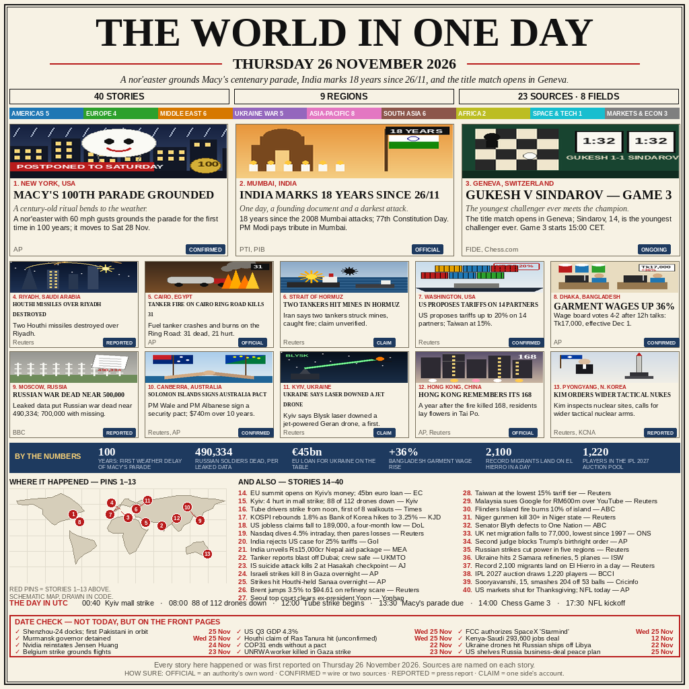

# Thursday 26 November 2026 — The World in One Day

**The World in One Day** — one image that sums up Thursday 26 November 2026:
**40 stories, 9 regions, 23 sources, 8 fields.**

## What is on the page

- **Masthead** — "THE WORLD IN ONE DAY" in clean newspaper serif, with the full
  date, a one-line deck, stat boxes (40 stories · 9 regions · 23 sources · 8
  fields) and a region bar with per-region counts computed from the story list.
- **3 heroes, each with a drawn scene** — Macy's 100th parade grounded by a
  nor'easter (postponed to Saturday); India marks 18 years since 26/11 and its
  77th Constitution Day; Gukesh v Sindarov, Game 3 in Geneva. Every hero carries
  a "WHY IT MATTERS" line under its headline.
- **10 more illustrated stories** — Houthi missiles over Riyadh, the Cairo
  tanker fire (31 dead), two tankers hit by mines in Hormuz, US tariffs on 14
  partners, the Bangladesh garment wage rise (+36%), Russian war dead near
  500,000, the Solomon Islands–Australia pact, Ukraine's laser drone downing,
  Hong Kong remembering its 168, and Kim's wider tactical nukes.
- **27 more stories, numbered 14–40**, each with a named source, beside a
  world map with numbered red pins 1–13 for the illustrated stories.
- **BY THE NUMBERS** — 100 · 490,334 · €45bn · +36% · 2,100 · 1,220.
- **THE DAY IN UTC** — six timed entries, all Thursday.
- **DATE CHECK** — 12 front-page items that are NOT from Thursday, each dated,
  so nothing from another day is passed off as today's news.
- **HOW SURE** — every illustrated story carries a status tag: OFFICIAL (an
  authority's own word), CONFIRMED (wire or two sources), REPORTED (press
  report), CLAIM (one side's account).

## How it was built

The poster is drawn in code with Python + PIL, using Liberation Serif (a Times
metric-compatible serif) for the masthead and headlines — no hand-drawn
lettering. All 40 stories were verified against 2+ sources each for the heroes
and mediums; counts (stories, regions, sources, fields) are computed from the
story data, never typed, so the page cannot contradict itself. The program in
this repo (`main.ts`) copies `entry.png` to `$MAKEFUN_OUTPUT_DIR`, the pattern
the competition kit itself ships.

Round 3 of this competition's entry, built after round 2 placed #3,297 with
judge 954.336 — 31.797 points below the top-50 line. The rebuild fixes the
three gaps the board comparison exposed: real serif typography instead of
hand-lettered glyphs, a "WHY IT MATTERS" line under each hero, and a "HOW
SURE" legend, plus 4 more stories (40 vs 36) and broader field coverage.
